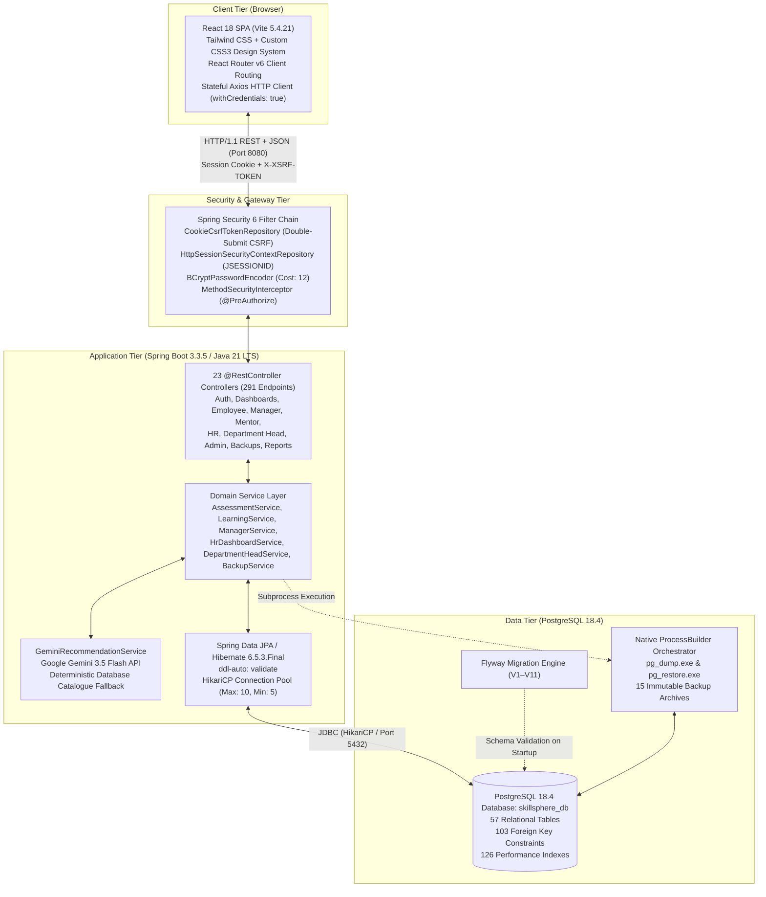
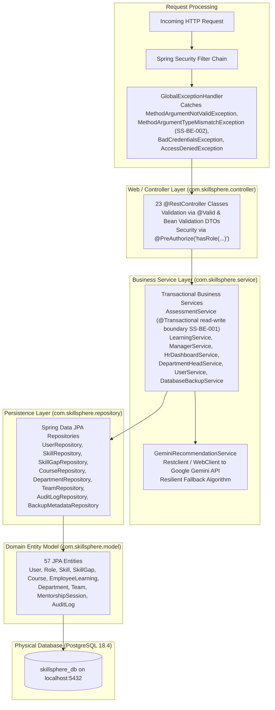
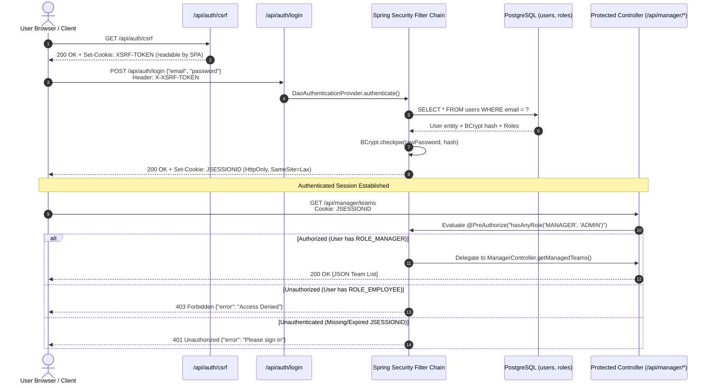
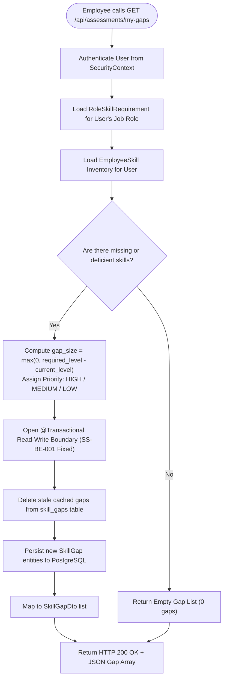
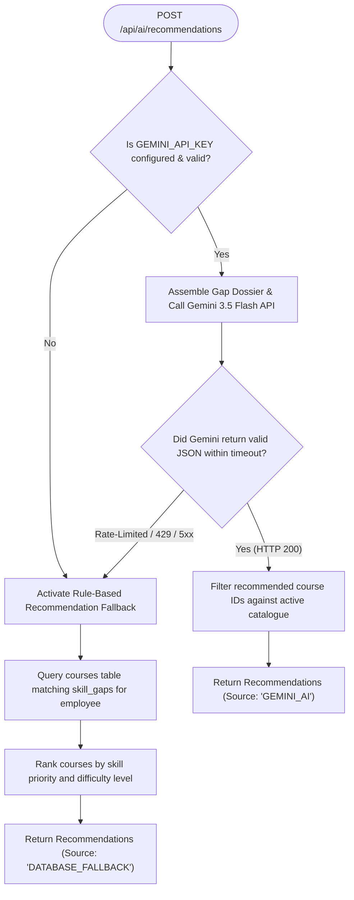
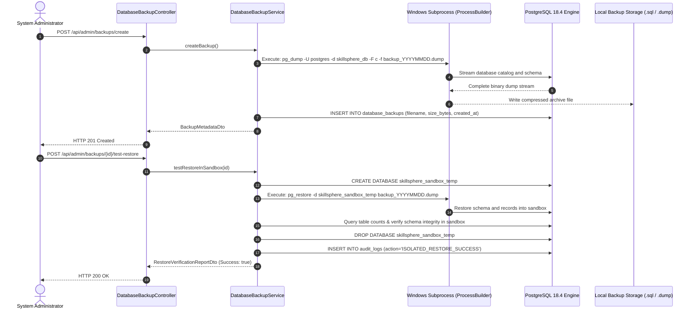

# SkillSphere — System & Software Architecture Specification

**Project:** SkillSphere — Organizational Knowledge Gap Intelligence Platform  
**Internship:** Infosys Springboard Virtual Internship 7.0  
**Version:** 2.0 (Post-Phase 6 Production Acceptance)  
**Status:** Approved & Implemented  
**Date:** November 18, 2026  

---

## 1. High-Level System Architecture

SkillSphere is architected as an enterprise single-page application (SPA) backed by a robust, secure, stateful RESTful service and a native relational database. The platform integrates external generative artificial intelligence (Google Gemini API) for dynamic assessment authoring and intelligent course recommendations, coupled with a native PostgreSQL database backup and sandbox recovery engine.



---

## 2. Frontend Component Architecture

The frontend is built with React 18 and Vite 5, structured into modular page workspaces corresponding to the six organizational roles, unified by a shared enterprise layout and responsive design primitives.

```mermaid
graph TD
    subgraph Core App Shell
        Main["main.jsx / App.jsx"] --> Router["React Router v6 Browser Router"]
        Router --> AuthProvider["AuthContext / ProtectedRoute"]
    end

    subgraph Shared Layout Components
        AuthProvider --> DashboardLayout["DashboardLayout.jsx<br/>Glassmorphic Sidebar (Desktop)<br/>Collapsible Header + Touch Drawer (Mobile)<br/>Active Role Pill & Session Indicator"]
        DashboardLayout --> KpiCard["KpiCard.jsx (Metric, Trend, Icon)"]
        DashboardLayout --> DataTable["DataTable.jsx (Sort, Filter, Pagination)"]
        DashboardLayout --> EmptyState["EmptyState.jsx (Illustration, Action)"]
    end

    subgraph Six Role Workspaces
        DashboardLayout --> EmployeeDash["EmployeeDashboard.jsx (21 Subviews)"]
        DashboardLayout --> ManagerDash["ManagerDashboard.jsx (13 Subviews)"]
        DashboardLayout --> MentorDash["MentorDashboard.jsx (10 Subviews)"]
        DashboardLayout --> HrDash["HrDashboard.jsx (15 Subviews)"]
        DashboardLayout --> DeptHeadDash["DepartmentHeadDashboard.jsx (11 Subviews)"]
        DashboardLayout --> AdminDash["AdminDashboard.jsx (12 Subviews)"]
    end

    subgraph Service Layer (Axios)
        EmployeeDash -.-> ApiServices["services/api.js<br/>authService, employeeProfileService, managerService,<br/>mentorService, hrService, deptHeadService, adminService"]
        ManagerDash -.-> ApiServices
        MentorDash -.-> ApiServices
        HrDash -.-> ApiServices
        DeptHeadDash -.-> ApiServices
        AdminDash -.-> ApiServices
    end
```

### Component Breakdown
- **`DashboardLayout.jsx`**: Enterprise wrapper supporting dynamic role-swapping, mobile navigation drawers, responsive collapse states ($\ge 1024\text{px}$ desktop sidebar, $< 1024\text{px}$ off-canvas hamburger drawer), user notification badges, and session logout controls.
- **`KpiCard.jsx`**: High-contrast, WCAG AA compliant metric container rendering numerical KPIs, percentage trend badges, and contextual Feather icons.
- **`DataTable.jsx`**: Standardized tabular display with column sorting, live search filtering, pagination controls, and mobile-friendly responsive wrappers.
- **`EmptyState.jsx`**: Friendly graphical placeholder rendered when queries return zero records (e.g., unassigned mentors, empty reassessment queues).

---

## 3. Backend Layered Architecture

The backend follows clean layered architecture principles, ensuring strict separation of concerns, dependency injection, and centralized exception handling.



---

## 4. Authentication, Authorization & Session Flow

SkillSphere adopts a stateful session architecture with enterprise CSRF double-submit protection:



---

## 5. Core Business Workflow Diagrams

### 5.1 Dynamic Skill Gap Derivation & Persistence Engine
When an employee views their skill gaps, the system computes differences between their current assessed skills and the required competencies for their job role:



### 5.2 Gemini AI Recommendation Engine with Graceful Fallback
Course recommendations leverage Google Gemini generative intelligence with an automatic database fallback:



### 5.3 PostgreSQL Backup & Isolated Sandbox Restore Workflow
Platform integrity and disaster recovery are maintained via native PostgreSQL CLI utilities:



---

*SkillSphere Architecture Specification approved for production baseline.*
