# SkillSphere — Database Schema & Data Dictionary Specification

**Project:** SkillSphere — Organizational Knowledge Gap Intelligence Platform  
**Internship:** Infosys Springboard Virtual Internship 7.0  
**Database Engine:** PostgreSQL 18.4 (x86_64) on `localhost:5432`  
**Database Name:** `skillsphere_db`  
**Schema:** `public` (57 Tables, 103 Foreign Keys, 126 Indexes)  
**Migration Tool:** Flyway Core (V1 through V11)  
**Hibernate Strategy:** `spring.jpa.hibernate.ddl-auto: validate`  
**Audit Date:** November 18, 2026  

---

## 1. Flyway Migration Version History (V1–V11)

The SkillSphere database is strictly version-controlled via 11 automated Flyway migrations. All migrations execute sequentially in the `public` schema and are tracked within `flyway_schema_history`:

| Rank | Version | Migration Script Name | Description | State | Installed On |
|:---:|:---:|:---|:---|:---:|:---:|
| 1 | **V1** | `V1__create_users.sql` | Core user identity, BCrypt credentials, roles, departments, teams | `SUCCESS` | Baseline |
| 2 | **V2** | `V2__create_password_reset_tokens.sql` | Password reset token storage and expiration tracking | `SUCCESS` | Baseline |
| 3 | **V3** | `V3__create_mentorship_tables.sql` | Mentorship relationships, pairing requests, and session logs | `SUCCESS` | Baseline |
| 4 | **V4** | `V4__complete_platform_schema.sql` | Enterprise schema expansion: assessments, courses, learning progress | `SUCCESS` | Baseline |
| 5 | **V5** | `V5__fix_schema_validation_columns.sql` | Hibernate column type and nullability harmonization | `SUCCESS` | Baseline |
| 6 | **V6** | `V6__dynamic_assessment_enhancements.sql` | Question bank options, attempts, and dynamic gap calculation | `SUCCESS` | Baseline |
| 7 | **V7** | `V7__manager_dashboard_enhancements.sql` | Manager team heatmaps, skill inventories, and review queues | `SUCCESS` | Baseline |
| 8 | **V8** | `V8__mentor_dashboard_enhancements.sql` | Mentor profiles, goal action items, and session tracking | `SUCCESS` | Baseline |
| 9 | **V9** | `V9__hr_dashboard_enhancements.sql` | HR competency frameworks, role requirements, training courses | `SUCCESS` | Baseline |
| 10 | **V10** | `V10__chat_enhancements.sql` | Real-time conversations, participants, messages, and reports | `SUCCESS` | Baseline |
| 11 | **V11** | `V11__add_cancelled_to_training_programmes.sql` | Support for training programme cancellation status | `SUCCESS` | Baseline |

---

## 2. Entity-Relationship (ER) Diagram

The following Mermaid ER diagram illustrates the authoritative relationships, primary keys, and foreign keys across SkillSphere's core relational clusters:

```mermaid
erDiagram
    %% 1. Identity & Organization
    USERS ||--o{ EMPLOYEE_PROFILES : "has profile"
    USERS ||--o{ MENTOR_PROFILES : "has profile"
    USERS }o--|| DEPARTMENTS : "belongs to"
    USERS ||--o{ TEAM_MEMBERSHIPS : "joins"
    TEAMS ||--o{ TEAM_MEMBERSHIPS : "contains"
    DEPARTMENTS ||--o{ TEAMS : "houses"
    DEPARTMENTS ||--o{ HR_ANNOUNCEMENTS : "publishes to"

    %% 2. Skills & Gaps
    SKILL_CATEGORIES ||--o{ SKILLS : "categorizes"
    SKILLS ||--o{ EMPLOYEE_SKILLS : "evaluated in"
    USERS ||--o{ EMPLOYEE_SKILLS : "possesses"
    SKILLS ||--o{ ROLE_SKILL_REQUIREMENTS : "required in"
    SKILLS ||--o{ SKILL_GAPS : "deficit in"
    USERS ||--o{ SKILL_GAPS : "exhibits"

    %% 3. Assessments
    SKILLS ||--o{ ASSESSMENT_QUESTIONS : "tests"
    SKILLS ||--o{ SKILL_ASSESSMENTS : "assessed via"
    USERS ||--o{ ASSESSMENT_ATTEMPTS : "takes"
    ASSESSMENT_ATTEMPTS ||--o{ ASSESSMENT_RESPONSES : "records"
    ASSESSMENT_QUESTIONS ||--o{ ASSESSMENT_RESPONSES : "answers"

    %% 4. Learning & Development
    SKILLS ||--o{ COURSES : "teaches"
    USERS ||--o{ EMPLOYEE_LEARNING : "enrolls in"
    COURSES ||--o{ EMPLOYEE_LEARNING : "enrolled"
    COURSES ||--o{ MANAGER_COURSE_RECOMMENDATIONS : "recommended"
    USERS ||--o{ CERTIFICATES : "awarded"

    %% 5. Mentorship
    USERS ||--o{ MENTORSHIP_REQUESTS : "initiates"
    USERS ||--o{ MENTOR_ASSIGNMENTS : "mentors"
    USERS ||--o{ MENTORSHIP_SESSIONS : "conducts"
    USERS ||--o{ MENTORSHIP_GOALS : "targets"

    %% 6. Chat & Social
    CONVERSATIONS ||--o{ CONVERSATION_PARTICIPANTS : "includes"
    USERS ||--o{ CONVERSATION_PARTICIPANTS : "participates"
    CONVERSATIONS ||--o{ MESSAGES : "contains"
    USERS ||--o{ MESSAGES : "sends"
    USERS ||--o{ NOTIFICATIONS : "receives"
    USERS ||--o{ AUDIT_LOGS : "logs actions"

    USERS {
        bigint id PK
        varchar email UK
        varchar password
        varchar full_name
        varchar role
        varchar status
        bigint department_id FK
        timestamp created_at
    }

    DEPARTMENTS {
        bigint id PK
        varchar name UK
        varchar code
        bigint head_id FK
        text description
    }

    TEAMS {
        bigint id PK
        varchar name
        bigint department_id FK
        bigint manager_id FK
    }

    SKILLS {
        bigint id PK
        varchar name UK
        text description
        bigint category_id FK
    }

    SKILL_GAPS {
        bigint id PK
        bigint user_id FK
        bigint skill_id FK
        integer current_level
        integer required_level
        integer gap_size
        varchar priority
        timestamp calculated_at
    }

    COURSES {
        bigint id PK
        varchar title
        varchar level
        integer duration_hours
        bigint skill_id FK
        varchar course_url
        boolean is_active
    }

    EMPLOYEE_LEARNING {
        bigint id PK
        bigint user_id FK
        bigint course_id FK
        integer progress_pct
        varchar status
        timestamp enrolled_at
        timestamp completed_at
    }

    AUDIT_LOGS {
        bigint id PK
        varchar action
        bigint user_id FK
        varchar user_email
        text details
        varchar ip_address
        timestamp timestamp
    }
```

---

## 3. Data Dictionary: Complete 57-Table Inventory

The table below catalogs every table in the `public` schema with row counts observed following Phase 6 end-to-end testing:

| # | Table Name | Primary Key | Key Foreign Keys | Purpose & Relational Role | Live Rows |
|:---:|:---|:---:|:---|:---|:---:|
| 1 | `users` | `id` | `department_id` $\rightarrow$ `departments(id)` | Master user identity, BCrypt hashes, roles, and status | 50 |
| 2 | `departments` | `id` | `head_id` $\rightarrow$ `users(id)` | Organizational departments and appointed department heads | 17 |
| 3 | `teams` | `id` | `department_id` $\rightarrow$ `departments(id)`, `manager_id` $\rightarrow$ `users(id)` | Department teams managed by designated managers | 2 |
| 4 | `team_memberships` | `id` | `team_id` $\rightarrow$ `teams(id)`, `user_id` $\rightarrow$ `users(id)` | Association linking employees to teams | 2 |
| 5 | `employee_profiles` | `id` | `user_id` $\rightarrow$ `users(id)` | Employee resumes, biographies, titles, and phone details | 18 |
| 6 | `mentor_profiles` | `id` | `user_id` $\rightarrow$ `users(id)` | Mentor expertise areas, bios, max mentees capacity | 16 |
| 7 | `skills` | `id` | `category_id` $\rightarrow$ `skill_categories(id)` | Authoritative organizational skill catalogue | 21 |
| 8 | `skill_categories` | `id` | None | Groupings (Technical, Leadership, Quality, Data) | 5 |
| 9 | `employee_skills` | `id` | `user_id` $\rightarrow$ `users(id)`, `skill_id` $\rightarrow$ `skills(id)` | User-assessed or endorsed skill proficiencies (1–5 scale) | 6 |
| 10 | `skill_evidence` | `id` | `employee_skill_id` $\rightarrow$ `employee_skills(id)` | URLs and proof of skill proficiency artifacts | 0 |
| 11 | `role_skill_requirements`| `id` | `skill_id` $\rightarrow$ `skills(id)` | Target skill proficiencies per job role | 14 |
| 12 | `skill_gaps` | `id` | `user_id` $\rightarrow$ `users(id)`, `skill_id` $\rightarrow$ `skills(id)` | Dynamically calculated gaps ($\max(0, \text{Req} - \text{Cur})$) | 15 |
| 13 | `skill_assessments` | `id` | `skill_id` $\rightarrow$ `skills(id)` | Test configurations and passing criteria | 1 |
| 14 | `assessment_questions` | `id` | `skill_id` $\rightarrow$ `skills(id)` | Curated question bank (options A, B, C, D, correct answer) | 86 |
| 15 | `assessment_attempts` | `id` | `user_id` $\rightarrow$ `users(id)`, `skill_id` $\rightarrow$ `skills(id)` | High-level attempt logs with final scores | 1 |
| 16 | `assessment_submissions`| `id` | `user_id` $\rightarrow$ `users(id)` | Detailed submission records with time spent | 2 |
| 17 | `assessment_responses` | `id` | `submission_id` $\rightarrow$ `assessment_submissions(id)` | Question-level responses and scoring breakdowns | 22 |
| 18 | `assessment_assignments`| `id` | `user_id` $\rightarrow$ `users(id)` | Mandatory assessment assignments from HR or Managers | 0 |
| 19 | `reassessment_requests` | `id` | `user_id` $\rightarrow$ `users(id)`, `skill_id` $\rightarrow$ `skills(id)` | Re-test requests pending manager approval | 0 |
| 20 | `courses` | `id` | `skill_id` $\rightarrow$ `skills(id)` | Internal & external courses (Coursera, Duke, etc.) | 26 |
| 21 | `employee_learning` | `id` | `user_id` $\rightarrow$ `users(id)`, `course_id` $\rightarrow$ `courses(id)` | Enrollments, `progress_pct`, and completion timestamps | 2 |
| 22 | `certificates` | `id` | `user_id` $\rightarrow$ `users(id)`, `course_id` $\rightarrow$ `courses(id)` | Cryptographic completion certificates with UUIDs | 1 |
| 23 | `learning_paths` | `id` | None | Curated multi-course curriculum programs | 0 |
| 24 | `learning_path_items` | `id` | `learning_path_id` $\rightarrow$ `learning_paths(id)` | Sequence of courses within a learning path | 0 |
| 25 | `manager_course_recommendations` | `id` | `manager_id`, `employee_id`, `course_id` | Manager-assigned course recommendations | 1 |
| 26 | `training_programmes` | `id` | None | Formal corporate training cohorts | 0 |
| 27 | `training_enrollments` | `id` | `programme_id` $\rightarrow$ `training_programmes(id)` | Employee registrations for corporate cohorts | 0 |
| 28 | `mentorship_requests` | `id` | `mentee_id`, `mentor_id`, `skill_id` | Pairing applications and approval workflows | 2 |
| 29 | `mentor_assignments` | `id` | `mentee_id`, `mentor_id` | Active mentorship pairings | 1 |
| 30 | `mentor_availability` | `id` | `mentor_id` $\rightarrow$ `users(id)` | Office hours and appointment slots | 0 |
| 31 | `mentor_evaluations` | `id` | `mentor_id`, `mentee_id` | Mentor competency assessment scores | 0 |
| 32 | `mentorship_sessions` | `id` | `mentor_id`, `mentee_id` | Logged 1-on-1 meeting records and agendas | 0 |
| 33 | `mentorship_goals` | `id` | `mentee_id`, `mentor_id` | Developmental targets agreed between mentor & mentee | 0 |
| 34 | `goal_action_items` | `id` | `goal_id` $\rightarrow$ `mentorship_goals(id)` | Granular sub-tasks under a mentorship goal | 0 |
| 35 | `mentorship_feedback` | `id` | `session_id` $\rightarrow$ `mentorship_sessions(id)` | Qualitative session ratings and reviews | 0 |
| 36 | `mentee_skill_consents` | `id` | `mentee_id`, `mentor_id` | GDPR/Data sharing consent for mentor gap visibility | 1 |
| 37 | `conversations` | `id` | None | Chat channels (direct or group) | 1 |
| 38 | `conversation_participants` | `id` | `conversation_id` $\rightarrow$ `conversations(id)`, `user_id` | Roster of users in a conversation | 2 |
| 39 | `messages` | `id` | `conversation_id`, `sender_id` | Individual chat messages with delivery state | 1 |
| 40 | `message_reports` | `id` | `message_id`, `reporter_id` | Moderation flags for inappropriate messages | 0 |
| 41 | `notifications` | `id` | `user_id` $\rightarrow$ `users(id)` | In-app alerts, read states, and target route links | 21 |
| 42 | `calendar_events` | `id` | `created_by` $\rightarrow$ `users(id)` | Scheduled mentorship and training sessions | 0 |
| 43 | `event_participants` | `id` | `event_id` $\rightarrow$ `calendar_events(id)` | Attendees invited to a calendar event | 0 |
| 44 | `knowledge_categories` | `id` | None | Knowledge hub categorization taxonomy | 4 |
| 45 | `knowledge_articles` | `id` | `category_id`, `author_id` | Knowledge base documentation and tutorials | 0 |
| 46 | `shared_resources` | `id` | `article_id`, `uploaded_by` | File attachments, documents, and reference PDFs | 0 |
| 47 | `discussion_threads` | `id` | `category_id`, `author_id` | Community forum topics | 0 |
| 48 | `discussion_replies` | `id` | `thread_id`, `author_id` | Forum responses and replies | 0 |
| 49 | `hr_announcements` | `id` | `author_id`, `department_id` | Broadcast announcements across organization | 2 |
| 50 | `hr_announcement_reads` | `id` | `announcement_id`, `user_id` | Read-receipt tracking for announcements | 0 |
| 51 | `leadership_report_shares` | `id` | `report_id`, `shared_by`, `shared_with` | Executive analytics reports shared across roles | 0 |
| 52 | `audit_logs` | `id` | `user_id` $\rightarrow$ `users(id)` | Immutable security audit trail (logins, restores, config) | 164 |
| 53 | `password_reset_tokens` | `id` | `user_id` $\rightarrow$ `users(id)` | Secure, single-use, time-bound password reset tokens | 2 |
| 54 | `system_configuration` | `id` | None | Key-value application parameters and settings | 4 |
| 55 | `support_tickets` | `id` | `user_id` $\rightarrow$ `users(id)` | User support requests and issue resolution | 0 |
| 56 | `platform_feedback` | `id` | `user_id` $\rightarrow$ `users(id)` | General user feedback and NPS ratings | 0 |
| 57 | `flyway_schema_history` | `installed_rank`| None | Flyway migration state, checksums, and timestamps | 11 |

---

## 4. Key Constraints & Performance Indexes

### 4.1 Schema Check Constraints
1. **`courses_level_check`**: `CHECK (level = ANY (ARRAY['Beginner'::varchar, 'Intermediate'::varchar, 'Advanced'::varchar]))` enforces strict Title Case level values.
2. **`users_role_check`**: Restricts role assignments strictly to `EMPLOYEE`, `MANAGER`, `MENTOR`, `HR_SPECIALIST`, `DEPARTMENT_HEAD`, `ADMIN`.
3. **`employee_skills_proficiency_check`**: Restricts proficiency ratings to integers $1$ through $5$ (`1=Unaware`, `2=Beginner`, `3=Intermediate`, `4=Advanced`, `5=Expert`).
4. **`employee_learning_progress_check`**: Restricts `progress_pct` to integers between $0$ and $100$.

### 4.2 Composite Performance Indexes (126 Total)
- `idx_users_email`: B-tree index on `users(email)` for sub-millisecond authentication lookups.
- `idx_skill_gaps_user_skill`: Composite index on `skill_gaps(user_id, skill_id)` for dynamic derivation checks.
- `idx_employee_learning_user_course`: Composite index on `employee_learning(user_id, course_id)` enforcing uniqueness and fast progress retrieval.
- `idx_team_memberships_team_user`: Composite index on `team_memberships(team_id, user_id)` for manager roster queries.
- `idx_audit_logs_timestamp`: B-tree index on `audit_logs(timestamp DESC)` for administrative security audit trails.

---

*SkillSphere Database Schema Specification verified against native PostgreSQL 18.4.*
