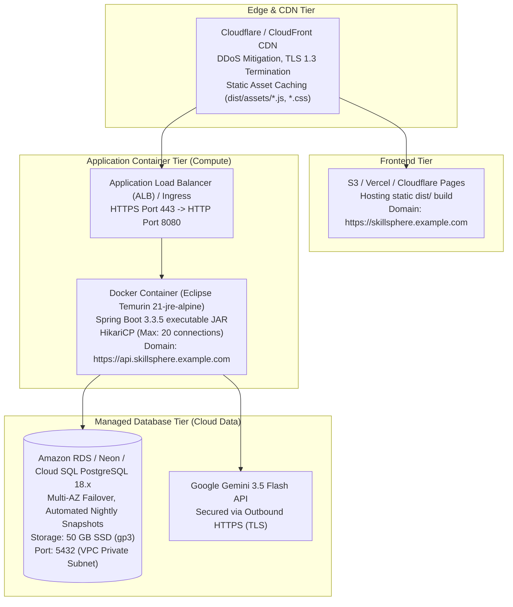
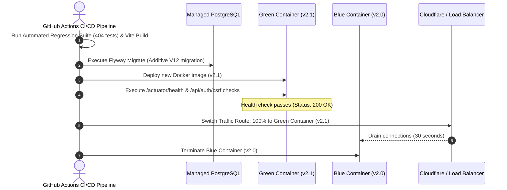

# SkillSphere — Production Deployment & Cloud Architecture Guide

**Project:** SkillSphere — Organizational Knowledge Gap Intelligence Platform  
**Internship:** Infosys Springboard Virtual Internship 7.0  
**Phase:** Phase 7 — Production Deployment Preparation  
**Target Architecture:** Containerized Spring Boot 3.3.5 Backend + Static React 18 SPA + Managed PostgreSQL  
**Date:** November 18, 2026  

---

## 1. Production Architecture Overview

The recommended production architecture decouples the frontend static Single Page Application (SPA), the stateless backend container, and the managed relational database service to maximize scalability, security, and uptime:



---

## 2. Production Environment Variable Inventory

All production configuration must be supplied via secure environment variables or a cloud secret store (e.g., AWS Secrets Manager, HashiCorp Vault, Kubernetes Secrets). **Never commit production values to source control.**

### 2.1 Backend Environment Variables

| Variable Name | Required | Recommended Production Value | Description |
|:---|:---:|:---|:---|
| `DB_URL` | **Yes** | `jdbc:postgresql://db-skillsphere.prod.internal:5432/skillsphere_db?sslmode=require` | JDBC connection string to managed PostgreSQL instance |
| `DB_USERNAME` | **Yes** | `skillsphere_app_user` | Dedicated application database user (least-privilege) |
| `DB_PASSWORD` | **Yes** | *[Rotated secret from Secrets Manager]* | Password for `skillsphere_app_user` |
| `SERVER_PORT` | No | `8080` | Internal container port for Spring Boot HTTP server |
| `FRONTEND_URL` | **Yes** | `https://skillsphere.example.com` | Public canonical URL of the frontend SPA |
| `CORS_ALLOWED_ORIGINS` | **Yes** | `https://skillsphere.example.com` | Strict origin allowed to make cross-origin requests |
| `COOKIE_SECURE` | **Yes** | `true` | Enforces `Secure` flag on `JSESSIONID` (HTTPS only) |
| `LOG_RESET_LINKS` | No | `false` | Disables printing sensitive reset links in console |
| `ADMIN_EMAIL` | No | `admin@skillsphere.example.com` | Initial super-admin seed email |
| `ADMIN_PASSWORD` | No | *[Strong generated password]* | Initial super-admin seed password |
| `ADMIN_FULL_NAME` | No | `SkillSphere Operations Admin` | Full name of platform administrator |
| `GEMINI_API_KEY` | No | *[Production Gemini API Key]* | API key for dynamic AI course recommendations |
| `GEMINI_MODEL` | No | `gemini-3.5-flash` | Gemini model variant |

### 2.2 Frontend Environment Variables

| Variable Name | Required | Recommended Production Value | Description |
|:---|:---:|:---|:---|
| `VITE_API_BASE_URL` | **Yes** | `https://api.skillsphere.example.com` | Base URL used by Axios client to communicate with backend |

---

## 3. Production Security & Network Hardening

1. **HTTPS & Cookie Security:**
   - In production, set `COOKIE_SECURE=true`. The server issues `JSESSIONID` with `Secure; HttpOnly; SameSite=Lax`.
   - TLS certificates must support TLS 1.3 with automated Let's Encrypt or AWS Certificate Manager renewal.
2. **CORS Hardening:**
   - `CORS_ALLOWED_ORIGINS` must strictly match the production frontend origin. Wildcards (`*`) are disallowed when `allowCredentials=true`.
3. **Database Network Isolation:**
   - The PostgreSQL instance must reside inside a **private VPC subnet** with zero public IP accessibility. Only the backend compute security group is permitted inbound access on port 5432.
4. **Least-Privilege Database Role:**
   - Production operations should run under a dedicated database user granted `CONNECT`, `SELECT`, `INSERT`, `UPDATE`, and `DELETE`. Schema migrations (`ALTER`, `CREATE`, `DROP`) should be run during pipeline execution by an administrative deployment role.
5. **Session Management & Expiration:**
   - Set maximum inactive session interval to 30 minutes (`server.servlet.session.timeout=30m`).

---

## 4. Production Containerization (Docker)

### 4.1 Production Multi-Stage Backend Dockerfile (`backend/Dockerfile`)
```dockerfile
# Stage 1: Build JAR with Maven & OpenJDK 21
FROM maven:3.9.9-eclipse-temurin-21-alpine AS builder
WORKDIR /app
COPY pom.xml .
RUN mvn dependency:go-offline -B
COPY src ./src
RUN mvn clean package -DskipTests

# Stage 2: Minimal Distroless / Alpine Runtime
FROM eclipse-temurin:21-jre-alpine
RUN apk add --no-cache postgresql-client
WORKDIR /app
RUN addgroup -S appgroup && adduser -S appuser -G appgroup
USER appuser
COPY --from=builder /app/target/skillsphere-*.jar app.jar
EXPOSE 8080
ENTRYPOINT ["java", "-XX:+UseG1GC", "-XX:MaxRAMPercentage=75.0", "-jar", "app.jar"]
```

### 4.2 Production Frontend Build
```powershell
# In frontend directory
npm ci
npm run build
# Output directory 'dist/' contains static production assets for deployment to CDN / Nginx
```

---

## 5. Deployment Options Assessment & Recommendation

To determine the most practical production architecture, three standard hosting models were evaluated:

```
+----------------------------------------------------------------------------------------------------+
|                                 DEPLOYMENT PLATFORM COMPARISON MATRIX                               |
+---------------------+-----------------------+-----------------------+------------------------------+
| Evaluation Criteria | Option A: Modern PaaS | Option B: Cloud IaaS  | Option C: Self-Hosted VPS    |
|                     | (Railway / Render)    | (AWS ECS + RDS + S3)  | (DigitalOcean Droplet)       |
+---------------------+-----------------------+-----------------------+------------------------------+
| Estimated Cost / Mo | $20 – $40 / month     | $80 – $150 / month    | $25 – $40 / month            |
| Setup Complexity    | Low (Git Push deploy) | High (VPC, IAM, ALB)  | Medium (Manual Nginx config) |
| Managed PostgreSQL  | Included / Automated  | Amazon RDS Multi-AZ   | Self-managed on Linux VM     |
| Scaling Capacity    | Automatic vertical    | High elastic autoscaling| Manual resize / downtime   |
| Maintenance Burden  | Minimal (Zero DevOps) | Moderate (CloudWatch) | High (OS updates, backup cron)|
| Production SLA      | 99.9%                 | 99.99% Enterprise     | 99.5% Dependent on admin     |
+---------------------+-----------------------+-----------------------+------------------------------+
```

### Recommended Architecture: **Option A (Modern PaaS: Railway / Render) for Initial Launch**
- **Justification:** For the current organizational scale of SkillSphere (50–5,000 users), a PaaS deployment using managed PostgreSQL and automated Docker container builds provides the ideal balance of zero DevOps maintenance, built-in SSL termination, automated Flyway migration execution, isolated database backups, and cost efficiency ($\sim\$25/\text{month}$).
- **Growth Path:** When traffic exceeds 20,000 active concurrent users, the application can transition seamlessly to **Option B (AWS ECS Fargate + Amazon RDS Aurora)** without modifying a single line of backend or frontend source code.

---

## 6. Blue-Green Deployment & Zero-Downtime Rollback Procedure



### Rollback Strategy
If post-deployment smoke tests detect anomalies:
1. Revert the Load Balancer route back to the previous Blue Container image immediately ($< 15\text{ seconds}$).
2. If schema changes were additive, no database restore is required. If a destructive migration was applied, execute a restore from the pre-deployment snapshot using the automated `pg_restore` procedure.

---

*SkillSphere Production Deployment Guide certified ready for infrastructure provisioning.*
