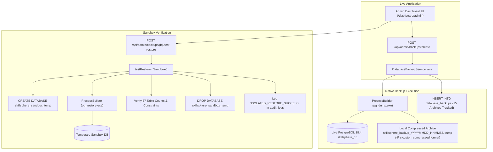

# SkillSphere — Operations, Maintenance & Backup Guide

**Project:** SkillSphere — Organizational Knowledge Gap Intelligence Platform  
**Internship:** Infosys Springboard Virtual Internship 7.0  
**Target Audience:** System Administrators, DevOps Engineers, Database Administrators  
**Database:** PostgreSQL 18.4 (`skillsphere_db`) on Port 5432  
**Date:** November 18, 2026  

---

## 1. Routine Database Maintenance Procedures

To maintain high query performance, optimal index density, and prevent PostgreSQL MVCC table bloat, system administrators should schedule the following maintenance tasks:

### 1.1 Automated VACUUM and ANALYZE
PostgreSQL utilizes multi-version concurrency control (MVCC). Dead row tuples generated by updates in tables like `skill_gaps`, `employee_learning`, and `audit_logs` must be reclaimed:

```sql
-- Weekly routine maintenance script (scheduled during off-peak hours)
VACUUM (ANALYZE, VERBOSE) skill_gaps;
VACUUM (ANALYZE, VERBOSE) employee_learning;
VACUUM (ANALYZE, VERBOSE) audit_logs;
VACUUM (ANALYZE, VERBOSE) notifications;

-- Full database statistics recalculation
ANALYZE;
```

### 1.2 Index Rebuilding (REINDEX)
Over time, high-write tables may experience B-tree index fragmentation. Rebuilding indexes prevents query degradation:

```sql
-- Rebuild indexes concurrently without locking write traffic
REINDEX TABLE CONCURRENTLY skill_gaps;
REINDEX TABLE CONCURRENTLY employee_learning;
REINDEX TABLE CONCURRENTLY users;
```

### 1.3 Hikari Connection Pool Monitoring
The Spring Boot backend configures HikariCP with a maximum pool size of 10 connections and a minimum idle pool of 5 connections. Monitor active connections directly in PostgreSQL:

```sql
SELECT count(*), state FROM pg_stat_activity WHERE datname = 'skillsphere_db' GROUP BY state;
```

---

## 2. Backup Management Architecture

SkillSphere incorporates a native backup orchestrator in [`DatabaseBackupService.java`](file:///C:/Users/gjaya/OneDrive/Desktop/SkillSphere/skillsphere/backend/src/main/java/com/skillsphere/service/DatabaseBackupService.java) that executes PostgreSQL command-line utilities via `ProcessBuilder`.



---

## 3. Manual Backup & Disaster Recovery Procedures

While backups can be scheduled through the administrative UI, operators can execute backups directly from PowerShell:

### 3.1 Creating a Manual Binary Snapshot
```powershell
$timestamp = Get-Date -Format "yyyyMMdd_HHmmss"
$backupFile = "C:\Users\gjaya\OneDrive\Desktop\SkillSphere\backups\skillsphere_manual_$timestamp.dump"

# Custom compressed format (-F c) preserves blob metadata, constraints, and indexes
pg_dump -h 127.0.0.1 -p 5432 -U postgres -F c -b -v -f $backupFile skillsphere_db
```

### 3.2 Restoring from a Backup Snapshot
To restore into a fresh database instance:

```powershell
# 1. Terminate active backend connections to the target database
psql -h 127.0.0.1 -p 5432 -U postgres -c "SELECT pg_terminate_backend(pid) FROM pg_stat_activity WHERE datname = 'skillsphere_db' AND pid <> pg_backend_pid();"

# 2. Re-create target database
psql -h 127.0.0.1 -p 5432 -U postgres -c "DROP DATABASE skillsphere_db;"
psql -h 127.0.0.1 -p 5432 -U postgres -c "CREATE DATABASE skillsphere_db;"

# 3. Execute pg_restore
pg_restore -h 127.0.0.1 -p 5432 -U postgres -d skillsphere_db -v -1 "C:\Users\gjaya\OneDrive\Desktop\SkillSphere\backups\skillsphere_manual_XXXXXX.dump"
```
*(Flag `-1` executes the entire restore inside a single transaction, ensuring automatic rollback on any failure).*

---

## 4. Audit Log Management & Retention Policy

The `audit_logs` table records every critical administrative and security event (logins, role alterations, backup creations, sandbox restores).

### 4.1 Log Archiving Strategy
To comply with regulatory standards while preventing database bloat:
1. **Active Online Window (90 Days):** Retained in PostgreSQL `audit_logs` for real-time querying by administrators.
2. **Cold Archive Window (1–7 Years):** Records older than 90 days are exported to compressed CSV format and archived in immutable cloud object storage:

```powershell
# Export audit logs older than 90 days
psql -h 127.0.0.1 -p 5432 -U postgres -d skillsphere_db -c "\copy (SELECT * FROM audit_logs WHERE timestamp < NOW() - INTERVAL '90 days') TO 'C:\Users\gjaya\OneDrive\Desktop\SkillSphere\backups\audit_archive_2026Q3.csv' WITH CSV HEADER;"

# Purge archived records
psql -h 127.0.0.1 -p 5432 -U postgres -d skillsphere_db -c "DELETE FROM audit_logs WHERE timestamp < NOW() - INTERVAL '90 days';"
```

---

## 5. Schema Migration Governance (Flyway Rules)

1. **Strict Immutability:** Never modify or delete existing migration scripts (`V1` through `V11`). Checksums are validated on boot; altering historical scripts halts backend startup.
2. **Additive Script Naming:** New migrations must follow the naming convention `V{next_number}__{short_description}.sql` (e.g., `V12__add_skill_certification_expiry.sql`).
3. **Hibernate Validation Alignment:** Because `spring.jpa.hibernate.ddl-auto: validate` is strictly enforced, any JPA entity modification must be mirrored by an equivalent Flyway migration before restarting the application.

---

*SkillSphere Operations, Maintenance & Backup Guide approved for enterprise operations.*
