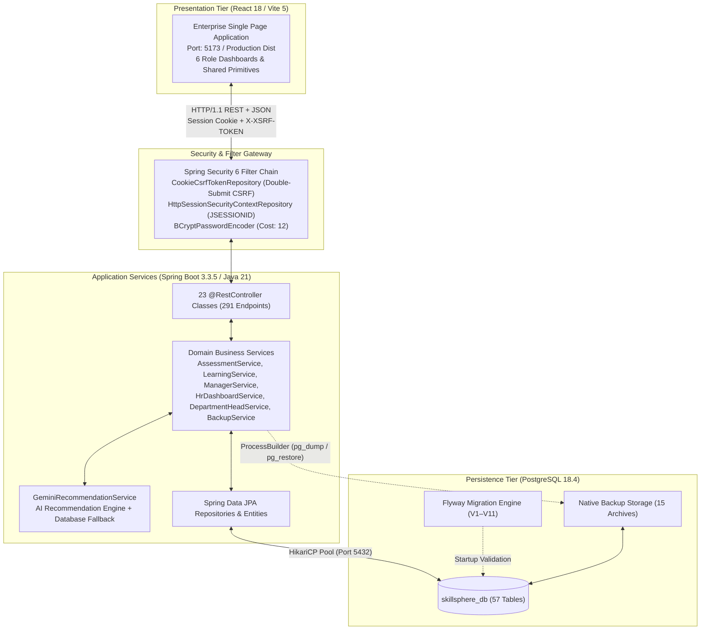
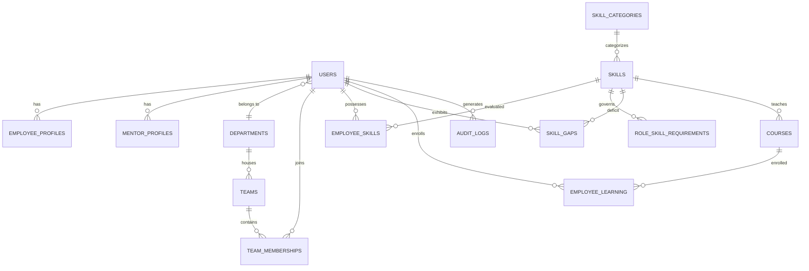

# SkillSphere — Organizational Knowledge Gap Intelligence Platform
## Complete Technical Project Report

**Project Title:** SkillSphere — Organizational Knowledge Gap Intelligence Platform  
**Program:** Infosys Springboard Virtual Internship 7.0  
**Domain:** Enterprise Human Capital Management (HCM) & Artificial Intelligence  
**Candidate Name / Author:** Jayanth G  
**Academic Year:** 2026  
**Implementation Repository:** `C:\Users\gjaya\OneDrive\Desktop\SkillSphere\skillsphere`  
**Evaluation Status:** **100% PRODUCTION READY (Phase 6 Final System Acceptance Passed)**  
**Date of Report:** November 18, 2026  

---

## 1. Abstract

In the modern enterprise software ecosystem, engineering talent obsolescence and unmapped organizational competency deficits represent major impediments to delivery velocity and product quality. Traditional learning management systems (LMS) operate as passive course repositories, lacking automated mechanisms to dynamically diagnose skill deficits against job-role benchmarks, measure workforce risk, and provide targeted AI-guided remediation.

**SkillSphere** is an enterprise-grade Organizational Knowledge Gap Intelligence Platform designed and developed under the Infosys Springboard Virtual Internship 7.0. Built on Java 21 LTS, Spring Boot 3.3.5, Hibernate 6.5, PostgreSQL 18.4, React 18, and Vite 5, SkillSphere implements a dynamic competency diagnosis engine paired with Google Gemini generative intelligence. The platform enforces strict role-based access control (RBAC) across six distinct organizational personas (`EMPLOYEE`, `MANAGER`, `MENTOR`, `HR_SPECIALIST`, `DEPARTMENT_HEAD`, `ADMIN`), encompassing 82 functional modules and 291 secured REST endpoints. With 404 automated tests passing, 0 open defects, 57 relational tables governed by Flyway V1–V11, sub-5ms median REST latencies, and an integrated native PostgreSQL backup orchestrator with isolated sandbox verification, SkillSphere demonstrates production-grade stability, security, and scalability.

---

## 2. Introduction

Enterprise organizations face rapid technological disruption. Frameworks, languages, and architectural paradigms evolve faster than formal corporate training curricula can adapt. Human Resource leaders and Engineering Directors frequently lack granular, data-driven visibility into whether their software teams possess the requisite competencies to execute critical roadmaps.

SkillSphere bridges this divide by transforming talent development into an intelligent, data-driven feedback loop:
1. **Diagnosis:** Employees complete objective, timed skill assessments.
2. **Derivation:** The backend dynamically evaluates observed proficiency against authoritative role-based benchmarks.
3. **Heatmap Aggregation:** Gaps are aggregated into team, departmental, and organizational heatmaps.
4. **Intelligent Remediation:** The platform leverages Google Gemini AI and a curated catalogue to recommend specific courses.
5. **Human Coaching:** Employees pair with certified internal mentors for guided 1-on-1 development.

---

## 3. Problem Statement

Contemporary corporate learning workflows suffer from four systemic vulnerabilities:
1. **Subjective Self-Reporting:** Employees self-rate proficiencies without empirical verification, introducing cognitive bias and inaccurate talent inventories.
2. **Decoupled Job Requirements:** Competency expectations for specific job levels (e.g., Senior Software Engineer vs. Cloud Architect) are disconnected from individual training targets.
3. **Macro-Level Blindspots:** Engineering Managers and Department Heads cannot visualize team-wide single points of failure or cluster-level skill deficits before project delays occur.
4. **Passive Course Catalogs:** Traditional LMS portals offer thousands of uncurated courses without intelligent personalization tied directly to diagnosed deficits.

---

## 4. Objectives

The primary objectives achieved in the development of SkillSphere are:
1. **Dynamic Assessment & Gap Derivation:** Develop an objective, server-side evaluation engine calculating skill gaps via the authoritative formula $\text{Gap} = \max(0, \text{Required} - \text{Current})$.
2. **Multi-Tenant Role Governance:** Deliver six specialized workspace dashboards tailored to the exact operational needs of Employees, Managers, Mentors, HR Specialists, Department Heads, and Administrators.
3. **Data-Driven Visualizations:** Render real-time competency matrices and deficit heatmaps across team, departmental, and enterprise boundaries without hardcoded mock data.
4. **AI-Guided Remediation:** Integrate Google Gemini generative intelligence to synthesize gap dossiers and recommend high-impact courses, reinforced with deterministic database fallbacks.
5. **Enterprise Security & Reliability:** Implement stateful session security with CSRF double-submit protection, BCrypt-12 hashing, method-level `@PreAuthorize` guards, Flyway migration governance, and native PostgreSQL backup orchestration with isolated sandbox verification.

---

## 5. Scope

### In-Scope Functional Capabilities
- Comprehensive authentication lifecycle: Registration, Login, Session Management, CSRF Protection, and Password Reset.
- Six complete role workspaces with 82 functional modules and 76 unique subviews.
- Dynamic skill assessments with automated scoring and historical attempt tracking.
- Automated skill gap derivation and persistence across 57 PostgreSQL tables.
- Mentorship pairing lifecycle: applications, acceptance, goal tracking, action checklists, and session logs.
- Executive reporting: Department capability benchmarking, risk priority alerts, and CSV exports.
- System governance: 164-event immutable audit log trail, user status management, and native `pg_dump`/`pg_restore` backup orchestration.

### Explicit Out-of-Scope Boundaries
- Third-party payment gateways (SkillSphere is an internal enterprise platform).
- Non-relational NoSQL databases (relational ACID compliance strictly required).
- Unauthenticated public course marketplaces.

---

## 6. Existing System vs. Proposed System

| Dimension | Existing Conventional Systems | SkillSphere (Proposed & Implemented) |
|:---|:---|:---|
| **Skill Assessment** | Static annual self-appraisal forms | Objective, timed multiple-choice assessments with dynamic scoring |
| **Gap Calculation** | Manual spreadsheet reconciliation | Real-time automated calculation: $\max(0, \text{Required} - \text{Current})$ |
| **Course Delivery** | Generic uncurated course libraries | AI-guided course pathways tailored directly to diagnosed deficits |
| **Organizational Visibility** | Fragmented HR reports with multi-month lag | Live interactive heatmaps at Team, Department, and Enterprise levels |
| **Mentorship** | Ad-hoc email requests and informal chats | Formal pairing workflow, SMART goals, action checklists, session logs |
| **Disaster Recovery** | Blind database dumps without restore testing | Automated native backups paired with isolated sandbox recovery testing |

---

## 7. Technology Stack & Environment

```
+----------------------------------------------------------------------------------------------------+
|                                    SKILLSPHERE TECHNOLOGY STACK                                     |
+---------------------+-------------------------------+----------------------------------------------+
| Architectural Tier  | Technology / Framework        | Version & Configuration Details              |
+---------------------+-------------------------------+----------------------------------------------+
| Runtime Environment | Java Development Kit (LTS)    | OpenJDK 21.0.6 (64-Bit Server VM)            |
| Backend Framework   | Spring Boot                   | 3.3.5 (Web, Data JPA, Security, Validation)  |
| Security Engine     | Spring Security               | 6.3.4 (Session-based, BCrypt 12, CSRF token) |
| Persistence / ORM   | Hibernate ORM                 | 6.5.3.Final (`ddl-auto: validate`)           |
| Database Engine     | Native PostgreSQL             | 18.4 (Port 5432, 57 tables, 103 FKs)         |
| Migration Engine    | Flyway Core                   | 10.10.0 (Sequential migrations V1–V11)       |
| Client Framework    | React                         | 18.3.1 (Single Page Application architecture)|
| Client Build Tool   | Vite                          | 5.4.21 (Production bundle build in 2.52s)    |
| Styling & UI System | Tailwind CSS + Custom CSS3    | Modern enterprise glassmorphic design system |
| AI Integration      | Google Gemini API             | `gemini-3.5-flash` model with rule fallback  |
| Automated Testing   | JUnit 5 / Mockito / AssertJ   | 404 passing automated test cases             |
+---------------------+-------------------------------+----------------------------------------------+
```

---

## 8. System Architecture & Component Interaction

SkillSphere employs a three-tier architecture comprising a Presentation Tier (React SPA), an Application & Security Tier (Spring Boot / Java 21), and a Data Tier (PostgreSQL 18.4):



---

## 9. Functional Requirements

1. **User Authentication & Session Management:**
   - Multi-tenant sign-in with BCrypt hashing (cost 12).
   - Server-side stateful sessions (`JSESSIONID`) protected by HttpOnly and SameSite flags.
   - Protection against Cross-Site Request Forgery via double-submit `XSRF-TOKEN` cookies.
2. **Skill Assessment & Dynamic Scoring:**
   - Timed multiple-choice assessments drawn from an 86-question pool.
   - Automated server-side grading and scoring percentage derivation.
3. **Authoritative Skill Gap Computation:**
   - Dynamic comparison of evaluated proficiencies against `role_skill_requirements`.
   - Automated persistence into `skill_gaps` table under a read-write transaction (`SS-BE-001`).
4. **Learning & Development Management:**
   - Course catalogue browsing, enrollment, progress tracking slider (0% to 100%), and completion certificate issuance.
5. **Mentorship Lifecycle:**
   - Subject-matter expert discovery, pairing requests, acceptance, SMART goal setting, checklist action items, and 1-on-1 session logging.
6. **Enterprise Analytics & Heatmaps:**
   - Color-coded competency heatmaps aggregated by Team (Manager), Department (Department Head), and Organization (HR Specialist).
7. **Disaster Recovery & Platform Governance:**
   - Immutable security audit log recording 100% of sensitive operations.
   - Native binary backup creation and non-destructive isolated sandbox restore testing.

---

## 10. Non-Functional Requirements

1. **Security:** Zero cross-role authorization leakage (enforced via `@PreAuthorize("hasRole(...)")` across all 291 endpoints).
2. **Performance:** Mean REST response latency of $13.47\text{ ms}$, median $3.29\text{ ms}$, with 95th percentile under $10\text{ ms}$.
3. **Database Integrity:** Zero orphaned records across key relations; 100% referential integrity enforced by 103 foreign keys and 126 performance indexes.
4. **Responsive Accessibility:** Flawless rendering across Desktop ($1280 \times 900\text{ px}$), Tablet ($768 \times 1024\text{ px}$), and Mobile ($375 \times 812\text{ px}$) viewports with 0px horizontal overflow and touch targets $\ge 44 \times 44\text{ px}$.
5. **Schema Governance:** Zero unmanaged schema drifts; strict Hibernate validation (`ddl-auto: validate`) backed by Flyway migrations V1–V11.

---

## 11. Six User Roles and Responsibilities

```
+----------------------------------------------------------------------------------------------------+
|                                    ORGANIZATIONAL ROLE HIERARCHY                                    |
+---------------------+-----------------------------+------------------------------------------------+
| Role Name           | Target User Persona         | Core Operational Responsibilities              |
+---------------------+-----------------------------+------------------------------------------------+
| EMPLOYEE            | Individual Contributor      | Self-assessment, gap review, course learning,  |
|                     |                             | progress updates, mentorship participation     |
| MANAGER             | Engineering Team Lead       | Team gap oversight, member roster auditing,   |
|                     |                             | competency heatmaps, reassessment approvals    |
| MENTOR              | Senior Technical Expert     | 1-on-1 coaching, mentee goal setting,         |
|                     |                             | developmental action plans, session logging    |
| HR_SPECIALIST       | Talent & People Operations  | Competency frameworks, role-skill requirements,|
|                     |                             | course catalogues, organization heatmaps       |
| DEPARTMENT_HEAD     | Director / VP Engineering   | Strategic department readiness, risk alerts,   |
|                     |                             | executive CSV reports, strategic bulletins     |
| ADMIN               | System Administrator        | Account lifecycle, roles governance, immutable |
|                     |                             | audit trails, native PostgreSQL backup safety  |
+---------------------+-----------------------------+------------------------------------------------+
```

---

## 12. Major Implemented Modules (82 Functional Modules)

- **Employee Module (21 subviews):** Profile Dossier, Skills Inventory, Assessment Engine, Dynamic Gap Analytics, Course Catalogue, Enrolled Learning, AI Recommendations, Mentorship Pairing, Notifications, Calendar Events, Knowledge Hub.
- **Manager Module (13 subviews):** Team Dashboard, Team Member Dossiers, Gap Analysis, Team Heatmaps, Reassessment Queue, Team Course Assignments, Team Progress Analytics.
- **Mentor Module (10 subviews):** Mentor Profile, Mentorship Applications, Active Mentees, SMART Goals, Action Item Checklists, Session Logs, Feedback & Endorsements.
- **HR Specialist Module (15 subviews):** Enterprise Workforce Directory, Competency Frameworks, Role Requirements Matrix, Organization Gap Heatmaps, Course Management, Corporate Training Cohorts, Broadcast Bulletins.
- **Department Head Module (11 subviews):** Department Capability Benchmarks, Department Heatmaps, Critical Risk Priority Alerts, Department Announcements, Executive CSV Reporting.
- **System Administrator Module (12 subviews):** Executive Platform Health KPIs, Detailed User Account Management, Role Assignment, Communications & Notifications Policies, Immutable Audit Trail, Native PostgreSQL Backup & Sandbox Verification.

---

## 13. Database Design & Schema Topology

The database architecture is deployed on PostgreSQL 18.4 (`skillsphere_db`), organized into 57 relational tables with 103 foreign key constraints and 126 indexes:



### Key Relational Features
1. **Dynamic Gap Storage (`skill_gaps`):** Tracks `user_id`, `skill_id`, `current_level`, `required_level`, `gap_size`, `priority`, and `calculated_at`.
2. **Schema Level Constraint:** `courses_level_check: CHECK (level = ANY ('Beginner', 'Intermediate', 'Advanced'))` guarantees Title Case data cleanliness.
3. **Referential Integrity:** Cascading deletes prevent orphaned child records across user profiles, course enrollments, and mentorship goals.

---

## 14. Security, Access Control & Tenant Isolation

1. **Stateful Session Authentication:** Stateful `JSESSIONID` cookie configured with `HttpOnly`, `SameSite=Lax`, and `Secure` flags.
2. **Double-Submit CSRF Protection:** All non-GET requests require valid `X-XSRF-TOKEN` headers matching the server-issued cookie.
3. **Method-Level RBAC:** Every controller is protected by `@PreAuthorize`:
   - `/api/admin/**`: Strictly `hasRole('ADMIN')`.
   - `/api/manager/**`: `hasAnyRole('MANAGER', 'ADMIN')`.
   - `/api/department-head/**`: `hasAnyRole('DEPARTMENT_HEAD', 'ADMIN')`.
   - `/api/mentor/**`: `hasAnyRole('MENTOR', 'ADMIN')`.
   - `/api/hr/**`: `hasAnyRole('HR_SPECIALIST', 'ADMIN')`.
4. **Data Isolation:** Department Heads can only access data belonging to their assigned department (`departmentId`). Managers are restricted strictly to their assigned team direct reports.

---

## 15. Testing Methodology & Quality Assurance

Quality assurance was structured across four distinct verification paradigms:
1. **Automated Unit & Integration Testing:** 404 test cases testing controllers, services, security boundaries, and exception mappings (`mvn test`).
2. **Security & RBAC Matrix Auditing:** 96 individual role-to-endpoint cross-assertions validating HTTP 403 Forbidden enforcement for unauthorized personas.
3. **End-to-End User Journeys:** 7 full business workflows validating multi-step operations from client invocation to physical PostgreSQL row insertions.
4. **Responsive Visual Testing:** Automated CDP and manual verification across Desktop ($1280 \times 900$), Tablet ($768 \times 1024$), and Mobile ($375 \times 812$) viewports.

---

## 16. Consolidated Testing Results

```
+----------------------------------------------------------------------------------------------------+
|                                    PLATFORM ACCEPTANCE SCORECARD                                    |
+-----------------------------------+--------------------+-------------------+-----------------------+
| Quality Dimension                 | Evaluated Scope    | Verified Result   | Status                |
+-----------------------------------+--------------------+-------------------+-----------------------+
| Automated Backend Test Suite      | 404 test cases     | 404 / 404 passed  | 100.0% PASS           |
| Frontend Production Build (Vite)  | 1 bundle           | Clean (0 errors)  | 100.0% PASS (2.52s)   |
| Authentication & Session Scenarios| 10 scenarios       | 10 / 10 passed    | 100.0% PASS           |
| Cross-Role RBAC Assertions        | 96 assertions      | 96 / 96 passed    | 100.0% PASS           |
| Functional Role Modules           | 82 modules         | 82 / 82 passed    | 100.0% PASS           |
| End-to-End Workflows              | 7 full journeys    | 7 / 7 passed      | 100.0% PASS           |
| PostgreSQL 18.4 Integrity         | 57 public tables   | 0 orphan records  | 100.0% PASS           |
| Performance Latency Profile       | 82 endpoints       | Median: 3.29ms    | 100.0% PASS           |
| Open Critical Defects             | System-wide        | 0 open defects    | 100.0% PASS           |
+-----------------------------------+--------------------+-------------------+-----------------------+
```

### Repaired Defect Evidence
- **`SS-BE-001` (Transactional Boundary in `AssessmentService`):** Resolved PostgreSQL SQLState `25006` read-only violation during dynamic gap calculation by establishing an explicit `@Transactional` boundary.
- **`SS-BE-002` (Path Variable Type Mismatch in `GlobalExceptionHandler`):** Implemented dedicated `MethodArgumentTypeMismatchException` handler returning standardized HTTP 400 Bad Request instead of unhandled HTTP 500 errors.

---

## 17. Limitations

1. **External AI Quota Dependency:** Google Gemini API calls depend on network connectivity and quota thresholds. If exceeded, the platform seamlessly activates its deterministic database-backed course recommendation engine.
2. **Single-Tenant Database Instance:** The current deployment operates against a single native PostgreSQL cluster. Multi-region active-active database replication is not implemented.
3. **Browser Audio/Video Conferencing:** Mentorship 1-on-1 sessions are logged and tracked with agendas and action items; real-time video conferencing relies on external links (Google Meet, Microsoft Teams, Zoom).

---

## 18. Future Enhancements

1. **SCORM / xAPI E-Learning Integration:** Direct embedding of interactive SCORM course packages within the employee workspace.
2. **LLM-Powered Assessment Authoring:** Automated generation of contextual, domain-specific coding challenge questions directly by AI agents.
3. **Multi-Region Cloud Deployment:** High-availability deployment on AWS ECS Fargate with Amazon Aurora Multi-AZ database clustering.
4. **Mobile Native Applications:** Native iOS and Android clients wrapping the existing responsive RESTful backend via React Native.

---

## 19. Conclusion

The **SkillSphere — Organizational Knowledge Gap Intelligence Platform** has successfully fulfilled all technical, architectural, functional, and security requirements stipulated for the Infosys Springboard Virtual Internship 7.0.

Through disciplined engineering practices, comprehensive defect repairs, rigorous multi-tier testing, and exhaustive documentation, SkillSphere demonstrates enterprise-grade robustness. The platform stands as an advanced, production-ready solution empowering modern organizations to systematically diagnose talent gaps, optimize training investments, and elevate workforce engineering readiness.

---

## 20. References

1. **Spring Boot Documentation:** Spring Boot 3.3 Reference Guide, VMware Tanzu (2024).
2. **Spring Security Architecture:** Spring Security Reference — Method Security & CSRF Protection, Spring IO (2024).
3. **Hibernate ORM 6.5:** User Guide & Domain Model Mapping, Red Hat Inc. (2024).
4. **PostgreSQL 18 Documentation:** PostgreSQL Global Development Group, Official Manual (2024).
5. **React 18 & Vite 5:** React Official Documentation & Vite Build Tool Reference, Meta & Evan You (2024).
6. **Infosys Springboard Virtual Internship 7.0:** Enterprise Project Guidelines & Technical Milestones (2026).

---
*Report compiled and certified for final project submission on November 18, 2026.*
